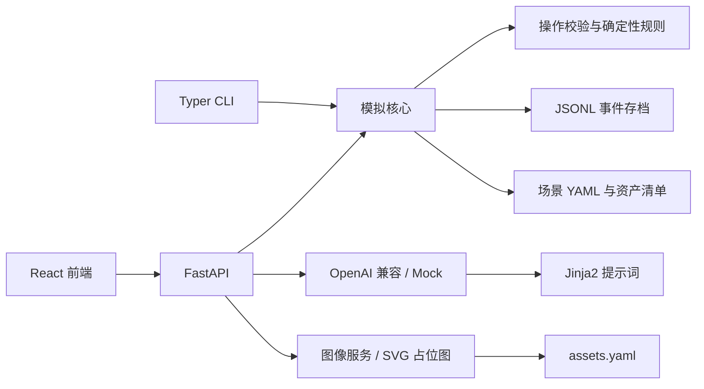
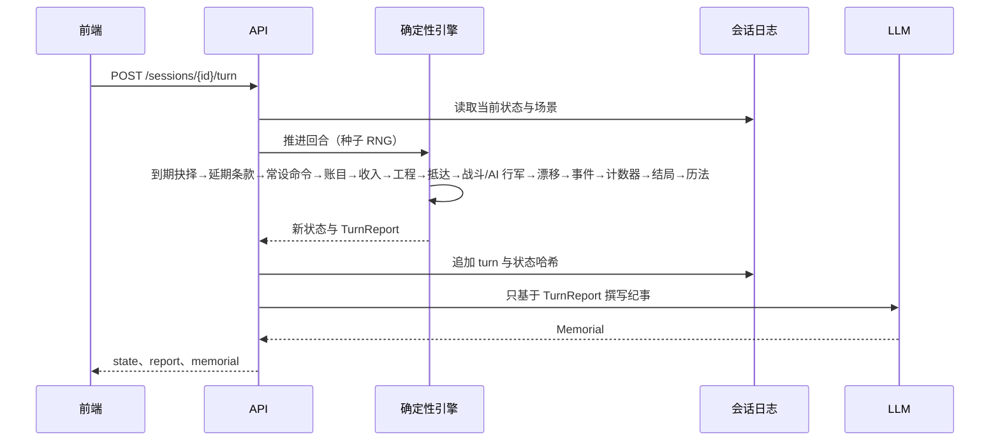
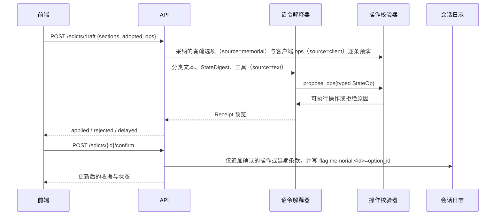

# 架构

## 模块关系

## 回合流水线

## 回合结算顺序（resolve_turn）

| # | 步骤 | 说明 |
|---|---|---|
| 1 | 到期抉择 | `deadline_turn` 已到的 PendingChoice 执行 `default_option`（条件不满足则取第一个可行选项），写入 `choice_default` 事实 |
| 2 | 延期条款 | 上季诏书中被判定延期的条款 |
| 3 | 常设命令 | `until_turn` 过期的先移除 |
| 4 | 账目 | one_off / recurring |
| 5 | 收入 | `formulas.income` 的每个键 `{resource, formula, per_region=true, label?, controlled_only?}`；地区公式可用该地区 stats、`turn`、`controlled` 与全部资源 |
| 6 | 工程 | 资金不足则停工 |
| 7 | 移动抵达 | 记录本季抵达的军队（用于占领判定） |
| 8 | 战斗与 AI 行军 | 同区敌对军队交战（关系 < 0 或场景 `wars`）；随后 `ai_routes` 令不在途、未与敌相持的军队前进一格 |
| 9 | 漂移 | 危机计分项与危机资源的漂移使用同一组变量快照 |
| 10 | 事件 | once / repeatable+cooldown；带 choices 的事件生成 PendingChoice（同一事件未决时不重复触发） |
| 11 | 计数器 | 场景 `counters`：streak 在条件不满足时归零，count 只累加 |
| 12 | 结局 | `endings` 按 priority 判定；到 `game_length.last_turn`（overtime_flag 为真时到 overtime_last_turn）仍无命中则用 fallback_ending |
| 13 | 历法 | T0 也按 turn_format 显示；每个 era 可带自己的 turn_format / number_system，年份按真实跨年计算（支持年中改元） |

所有随机来自 `random.Random(seed + turn)`：事件掷骰沿用主流；战斗使用从主流状态派生的独立流，不扰动事件序列。
`outcome` 非空即终局：resolve_turn 抛 `GameOver`，规则层对一切 op 返回 `GAME_OVER`；rewind / fork 仍可用。
测试设置 `SIM_CHECK_INVARIANTS=1`，每次结算后运行 `simcore/domain/invariants.py`。

## 公开视图与服务层

- `simcore/domain/visibility.py`：`public_view(state, seed)` 把 `hidden` 资源换成 `{estimate: [lo, hi]}`（半宽 = estimate_width ×（1 + corruption/100），flag `intel:<id>` 减半，中心带同回合稳定的种子噪声），并移除 `settings.hidden_traits` 中的人物心态；`public_report` 抹去报告里隐藏资源的数值，引用隐藏资源的危机分项只给区间。
- `simcore/service.py`：REST API 与 MCP 共用的 `GameService`（存档、视图、诏书草案、抉择、回合、廷议、谏言、时间线）。对外只返回公开视图；错误统一为 `GameError(code, message)`，API 映射为 `{"detail": {"code", "message"}}`。
- 完整状态仅 `GET /api/sessions/{id}/state?debug=1` 且设置 `SIM_DEBUG=1` 时可得。
- MCP 接入见 [MCP.md](MCP.md)。

## 诏令流水线

## 状态与模型边界

`WorldState` 是确定性规则的唯一运行状态。操作经 Pydantic 联合类型解析，再由规则层检查目标、资源、任职条件与场景限制。拒绝操作返回稳定错误码；LLM 只能通过工具提议操作，API 在确认阶段追加日志。

会话是带父节点的 JSONL 事件树。每个节点保存类型、父节点、时间与载荷；从日志可重放状态并计算 `state_hash`。分叉通过新日志头引用选定历史节点，不覆盖原存档。

模型提供方只负责文本生成与工具调用。程序负责规则、推进顺序、成本统计、请求超时和取消。详见 [PROVIDERS.md](PROVIDERS.md)。
