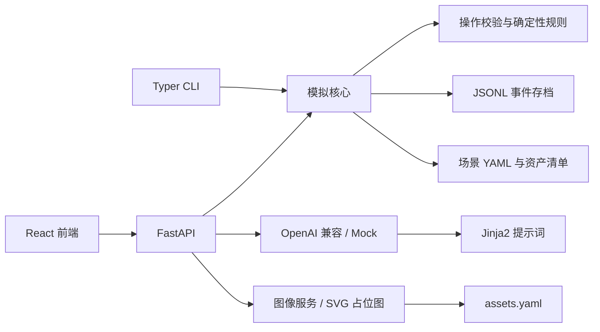
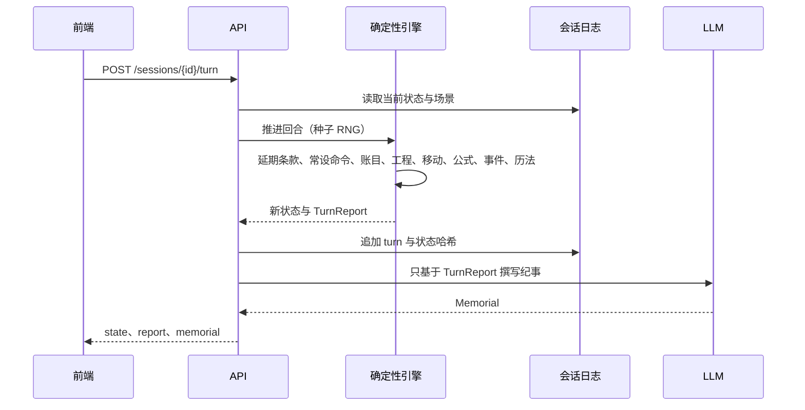
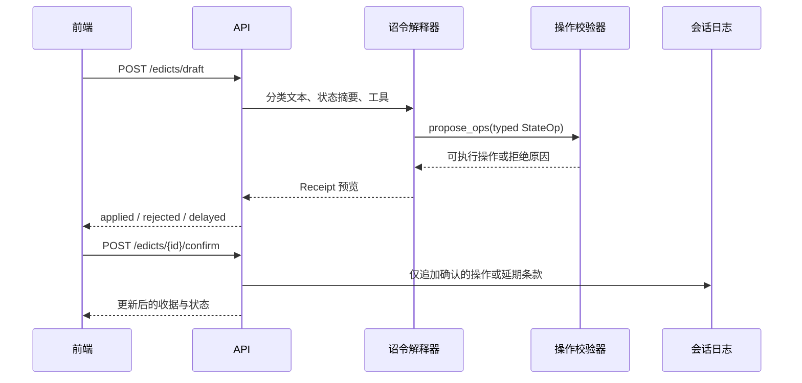

# 架构

## 模块关系

## 回合流水线

## 诏令流水线

## 状态与模型边界

`WorldState` 是确定性规则的唯一运行状态。操作经 Pydantic 联合类型解析，再由规则层检查目标、资源、任职条件与场景限制。拒绝操作返回稳定错误码；LLM 只能通过工具提议操作，API 在确认阶段追加日志。

会话是带父节点的 JSONL 事件树。每个节点保存类型、父节点、时间与载荷；从日志可重放状态并计算 `state_hash`。分叉通过新日志头引用选定历史节点，不覆盖原存档。

模型提供方只负责文本生成与工具调用。程序负责规则、推进顺序、成本统计、请求超时和取消。详见 [PROVIDERS.md](PROVIDERS.md)。
