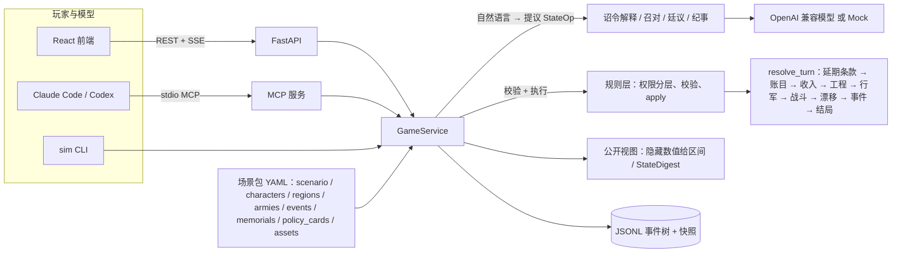

# llm-sim-game-template · LLM 模拟游戏模板

> **English summary.** A local-first, full-stack template for **LLM-driven simulation games**. A deterministic
> engine owns the world state; language models only *propose* typed state operations, which a rule layer
> validates before anything changes; narration is written only from facts that were actually applied.
> Saves are event-sourced JSONL with snapshots, so you can rewind and fork any timeline. Everything runs
> offline with a mock provider; plug in any OpenAI-compatible model (BYOK) per role when you want real
> prose. A built-in **MCP server** lets Claude Code or Codex play (and playtest) your game end to end.
> Scenarios are data packs (YAML + prompts + asset manifest): memorials with advisors, event choices,
> endings and fail states, difficulty levels, hidden values shown as rumour ranges, a crisis gauge,
> battles and AI marches, commander autonomy, policy cards, court agenda limits, courier delays and a
> tutorial — all scenario-agnostic. The flagship game built on it is
> [《天宝》 Tianbao](https://github.com/Yi-111-a/tianbao). Docs are in Chinese; MIT licensed.

一个本地优先、可离线运行的 **LLM 模拟游戏**全栈模板：

- **引擎拥有状态**：`WorldState` 只由确定性规则改变；所有随机都来自种子 RNG，同一存档重放得到同一状态哈希。
- **LLM 只提议类型化操作**：诏令解释、客户端模型（MCP）都只能提出 `StateOp`，规则层逐条校验，回执写明「可行 / 被拒（错误码）/ 延期（原因）/ 仅记录」；玩家只能用政策级操作，不能直接改数值。
- **叙事只来自已执行的事实**：纪事、召对、廷议都以引擎渲染的事实摘要（StateDigest）为唯一数值来源，隐藏数值只给区间。
- **事件溯源存档**：JSONL 事件树 + 每回合状态快照，可回放、回退（rewind）、分叉（fork），剧本改动不会追溯改写已结算的回合。
- **离线可玩**：缺省 Mock provider 与 SVG 占位图，无需任何密钥即可从开局玩到结局（含离线纪事、离线召对与廷议）。
- **BYOK**：任何 OpenAI 兼容服务（OpenAI、DeepSeek、Qwen、GLM、Ollama……），可按角色分别路由模型。
- **MCP 服务**：Claude Code / Codex 可以直接开局、读简报、召对、廷议、下诏、处置事件、推进回合、导出复盘日志。

## 功能一览

| 类别 | 引擎能力（全部场景无关，由剧本 YAML 配置） |
|---|---|
| 决策 | **奏疏**（memorials）：谏言人与立场、「所议之案」、谏言人在场校验（`requires`）、按局势出现的变体；**事件抉择**（带条件的选项、逾期默认）；**政令卡**（参数按局势过滤）；自由文字诏令（接模型时解释为 ops） |
| 终局 | **结局 / 失败**按优先级判定、**时限与加时**（`game_length`）、终局季提示、终局复盘（要事时间线、命中条件） |
| 难度 | **难度档**：漂移、事件概率、开局资源、诏令延期概率的系数 |
| 信息 | **隐藏数值**以「约 a–b（风闻）」显示，情报旗标收窄区间且有精度上限；**危机计**（分项、档位、本季变化拆分）；分段对账与经常收支明细 |
| 军事 | **战斗**（兵力 × 素质 × 城防 × 军令 × 天时，战报给出因素）、**AI 行军路线**、`march` 率军出征、`detach` 分兵、**军令姿态**（坚守 / 进击 / 坚壁清野）、**将领自主**（拒命、改令、擅自出战）、**养兵**按兵额计费 |
| 朝廷 | 官职兼任与任所、统一的任命 / 易帅 / 赴任规则、**朝会日程上限**（每季召对 / 廷议次数）、**在场限制的廷议**（不在京者递书面议状）、召对方式（面见 / 书面奏对 / 遣使问对）、人物记忆 |
| 时空 | 路径寻路与行程、**驿程**（远地奏疏晚一季奏到、诏令晚一季令达、军报晚到）、历法（年号、改元、中文数字） |
| 引导 | **新手引导**步骤（按季、指向前端元素）、离线时的「御笔只记入史册」提示 |
| 安全 | **玩家操作分层**（剧本层可用全部 op，玩家层只有白名单，越权 `OP_NOT_PERMITTED`）、未确认草案阻止结算（`DRAFT_UNCONFIRMED`）、公开视图与调试视图分离 |
| 叙事 | **StateDigest** 固定格式事实摘要、离线史官（基于事实的「是季」体纪事）、离线召对 / 廷议、数字白名单防编造 |
| 工具 | `export_log` 结构化复盘日志、`sim replay` 哈希校验、`sim validate`、资产清单与 `sim gen-assets`、`scripts/simulate.py` 种子模拟、`scripts/content_lint.py` 文字与状态一致性检查、`scripts/agent_play.py` 让 GPT / Claude 自动试玩 |

## 旗舰示例：《天宝》

[《天宝》](https://github.com/Yi-111-a/tianbao)（天宝十载，751 年，扮演唐玄宗面对安史之乱前夜）是在本模板上做出的完整游戏：20 位人物、22 个地区、140 余个事件、180 条按局势变化的奏疏、27 张政令卡、三档难度、十余种结局，带精修的 React 前端、Tauri 桌面安装包和 Claude Code / Codex 接入。本仓库的引擎正是在做《天宝》的九轮迭代中扩展出来的；每一项机制都经过 GPT（Codex）与 Claude 经 MCP 的整局试玩检验。想看一个剧本包「写满之后」是什么样子，请读它的 `scenarios/tianbao_751/`。

本仓库自带的前端（`frontend/`）是**通用的最小界面**，用于开发与调试（存档、奏疏批答、诏书预览与确认、待决事件、推进回合、召对、设置）；精修的游戏界面在《天宝》仓库的 `app/`。

仓库内的场景：

- `scenarios/_template`：**可复制的起点**。5 人、4 地、8 季，但每种机制都有一个最小、可运行的示范；CI 中以「每项取首选」经 MCP 打到终局。
- `scenarios/chongzhen_1627`：独立创作的崇祯初政示例（较早的写法，只用了基础机制）。

## 快速开始

需要 Python 3.11+、Node.js 22+。

```bash
# 后端
cd backend
python -m venv .venv
source .venv/bin/activate            # Windows PowerShell: .venv\Scripts\Activate.ps1
pip install -e ".[dev]"
sim validate ../scenarios/_template
sim serve                            # http://127.0.0.1:8000 ，/health 探活

# 前端（另一个终端）
cd frontend
npm ci
npm run dev                          # Vite 把 /api 代理到 127.0.0.1:8000
```

默认 LLM 与图像提供方均为 `mock`，无需密钥即可完整游玩。要接入真实模型，在前端「设置」里选择预设或 custom，或在启动后端前设置环境变量（见 [.env.example](.env.example) 与 [PROVIDERS.md](PROVIDERS.md)）。

### 让 Claude Code / Codex 来玩（MCP）

MCP 服务走 stdio：`sim mcp`（等价于 `<venv python> -m cli.main mcp`）。存档目录 `LLM_SIM_HOME` 与前端共用，所以模型和你可以轮流玩同一局。

```bash
# Claude Code
claude mcp add llm-sim \
  -e SIM_SCENARIOS_DIR=/path/to/llm-sim-game-template/scenarios \
  -e LLM_SIM_HOME=$HOME/.llm-sim \
  -- /path/to/backend/.venv/bin/python -m cli.main mcp
# 然后在 Claude Code 里：/mcp 确认已连接，再说「用 llm-sim 开一局 _template，种子 1，玩到结局」

# Codex CLI
codex mcp add llm-sim \
  --env SIM_SCENARIOS_DIR=/path/to/llm-sim-game-template/scenarios \
  --env LLM_SIM_HOME=$HOME/.llm-sim \
  -- /path/to/backend/.venv/bin/python -m cli.main mcp
```

Codex 还需要在 `~/.codex/config.toml` 的 `[mcp_servers.llm-sim]` 下补两项（`codex mcp add` 不会写）：

```toml
startup_timeout_sec = 60                  # Python 冷启动 + 杀毒扫描可能超过默认超时，否则服务会悄悄挂不上
default_tools_approval_mode = "approve"   # codex exec 非交互运行时，否则每次工具调用都在等审批
```

Windows 下路径写 `C:/.../.venv/Scripts/python.exe`。完整说明、工具表与无人值守试玩见 [MCP.md](MCP.md) 和 [mcp-playtesting 技能](skills/mcp-playtesting/SKILL.md)。

## 架构



一季的流程：读 `/view`（或 MCP `briefing`）→ 批答奏疏、选政令卡、写诏令 → `draft` 得到逐条回执 → `confirm` 才写入日志 → 处置待决事件 → `turn` 结算（按种子 RNG）→ 纪事只复述结算出的事实。细节见 [ARCHITECTURE.md](ARCHITECTURE.md)。

## 文档索引

| 文档 | 内容 |
|---|---|
| [GETTING_STARTED.md](GETTING_STARTED.md) | 安装、启动、接模型、创建新场景 |
| [docs/SCENARIO_GUIDE.md](docs/SCENARIO_GUIDE.md) | **剧本写作指南**：逐文件、逐机制的可复制示例，校验、平衡模拟与内容检查清单 |
| [ARCHITECTURE.md](ARCHITECTURE.md) | 模块关系、回合结算顺序、公开视图、诏令流水线 |
| [MCP.md](MCP.md) | MCP 接入（Claude Code / Codex）与全部工具 |
| [PROMPTS.md](PROMPTS.md) | 提示词约定、StateDigest、廷议立场规则 |
| [PROVIDERS.md](PROVIDERS.md) | 模型提供方、按角色路由、工具调用回退 |
| [ASSETS.md](ASSETS.md) | 图片资产清单与占位图 |
| [CHANGELOG.md](CHANGELOG.md) | 版本变更 |
| [skills/](skills/create-llm-sim-game/SKILL.md) | 给 AI 编程助手的技能卡（场景设计、事件、状态建模、试玩……） |

## 检查

```bash
scripts/check.sh      # ruff、mypy、pytest、sim validate、content_lint、simulate、前端 tsc 与构建（与 CI 相同）
```

MIT 许可，详见 [LICENSE](LICENSE)。
