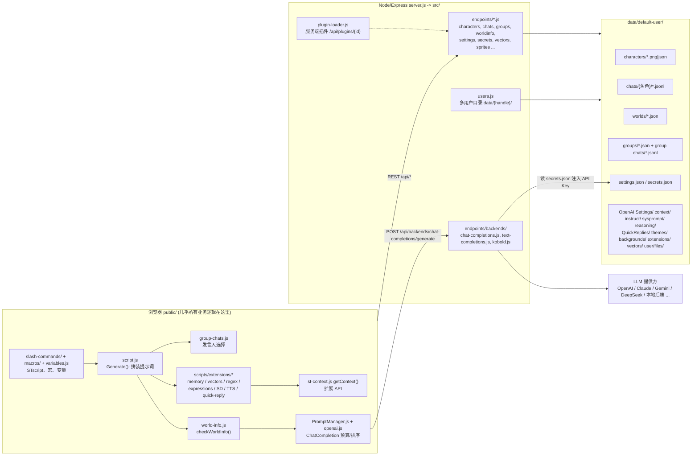

# SillyTavern（酒馆）调研笔记：给「LLM 驱动中国历史策略游戏」的借鉴

调研对象：`SillyTavern/SillyTavern`，`git clone --depth 1`，`package.json` 版本 1.19.0。
代码只读，没有执行 `npm install` 或任何脚本。
本文所有「文件:行」引用都来自上述快照。
标记 **[推断]** 的内容是我根据代码推测的，没有直接读到。
标记 **[外部]** 的内容来自网页检索（docs.sillytavern.app、GitHub README、搜索摘要），没有读源码。

---

## 1. 概览与许可

**它是什么。** SillyTavern 是本地自托管的 LLM 角色扮演前端。
- 它自己不做推理，而是把用户配置的各种后端（OpenAI 兼容、Claude、Gemini、本地 KoboldCpp、text-generation-webui 等）统一成一个聊天界面。
- 核心卖点是「提示词拼装」：角色卡、世界书（World Info）、作者注释、摘要、向量记忆等多个来源，按可配置的顺序和深度塞进上下文。
- 客户端很重，服务端很薄。

**许可。**
- `LICENSE` 是 GNU AGPL-3.0，`package.json` 的 `license` 字段也是 `AGPL-3.0`。
- 我们的仓库是 MIT。
- **结论：只借鉴思想、数据格式和算法描述，不复制、不移植、不逐行改写其代码。**
  - AGPL 的网络条款会让任何衍生的服务端也必须开源，与 MIT 不兼容。
  - 本文引用的字段名、枚举名是为了说明「别人怎么设计」，我们落地时应当按自己的 Pydantic 模型重新命名和实现。
  - 角色卡 V2/V3 是独立的公开规范（由社区维护，不是 ST 的代码），按规范实现是安全的。**[推断]** 我没有在本次调研里核对该规范自身的许可证，落地前请单独确认。
  - 第三方扩展各有各的许可证，同样不能直接拿来用。
- 实操建议：写代码时不要打开 ST 源码对照着敲。以本文第 5、7 节的「规格」为输入，由我们自己的测试驱动实现。

**规模感。**
- `public/script.js` 12599 行，`public/scripts/openai.js` 7396 行，`slash-commands.js` 7122 行，`world-info.js` 6408 行，`group-chats.js` 2491 行。
- 整个提示词管线是浏览器端的巨型单体，没有规则引擎。这对应我们要避免的形态（见第 6 节）。

---

## 2. 架构总图

### 2.1 总体结构



要点：

1. **服务端主要做三件事。**
   - 文件存储：角色、聊天、世界书、设置、素材。
   - 代理转发：把统一格式的请求翻译成各家 API，并把密钥留在服务端。
   - 辅助能力：分词、向量嵌入、情绪分类、图片/TTS 代理。
2. **提示词拼装全在浏览器端。**
   - 入口是 `public/script.js:4290` 的 `Generate(type, ...)`。
   - 它依次做：世界书扫描、作者注释、扩展注入、拼 story string 或走 Chat Completion 预算、触发生成拦截器（`runGenerationInterceptors`，`extensions.js:2024`）。
3. **状态没有「引擎」。**
   - 所有「状态」要么在聊天文本里，要么在 `chat_metadata.variables`（每个聊天一份）和 `extension_settings.variables.global`（写进 `settings.json`）里。
   - 模型输出什么，界面就显示什么。

### 2.2 服务端路由（`src/server-startup.js:141-169` 起）

| 路径 | 文件 | 作用 |
|---|---|---|
| `/api/characters` | `endpoints/characters.js` | 角色卡导入导出（PNG/JSON/CharX/BYAF），V1→V2 转换 |
| `/api/chats`, `/api/groups` | `endpoints/chats.js`, `groups.js` | JSONL 聊天读写、完整性校验、导入导出、搜索 |
| `/api/worldinfo` | `endpoints/worldinfo.js` | 世界书文件读写 |
| `/api/settings`, `/api/secrets` | `settings.js`, `secrets.js` | `settings.json`、`secrets.json`（密钥分开存放，默认不回传前端） |
| `/api/backends/chat-completions` | `backends/chat-completions.js`（2995 行） | 各家 Chat API 的请求翻译与流式转发 |
| `/api/vectors` | `vectors.js` | 向量库（`vectra`）的 insert/query/list/purge |
| `/api/sprites`, `/api/classify`, `/api/backgrounds`, `/api/themes` | 同名文件 | 立绘、情绪分类、背景、主题 |
| `/api/sd`, `/api/speech`, `/api/translate`, `/api/search` | 同名文件 | 图像、TTS、翻译、联网搜索代理 |
| `/api/extensions` | `extensions.js` | 通过 git 安装/更新第三方扩展 |
| `/api/plugins/{id}` | `plugin-loader.js` | 服务端插件挂载点 |

### 2.3 数据布局（`src/constants.js:16 USER_DIRECTORY_TEMPLATE`）

```
data/{handle}/                 # 多用户，默认 default-user
  characters/                  # 角色卡 PNG（tEXt 块里嵌 JSON）或 JSON
  chats/{角色名}/{聊天名}.jsonl
  groups/{timestamp}.json      # 群组定义
  group chats/{chat_id}.jsonl
  worlds/{名称}.json           # 世界书：{ entries: { "0": {...}, "1": {...} } }
  user/ (images, files, workflows)  # Data Bank 附件、ComfyUI 工作流
  backgrounds/  themes/  movingUI/  QuickReplies/
  OpenAI Settings/ context/ instruct/ sysprompt/ reasoning/ ...  # 各类预设
  extensions/                  # 用户安装的第三方扩展（git clone）
  vectors/                     # 向量索引
  settings.json  secrets.json
```

---

## 3. 逐项功能拆解

### 3.1 角色卡（Character Card V2/V3）

**是什么。** 一张带元数据的 PNG（或纯 JSON），描述一个可对话的人物。

**关键文件。**
- `src/character-card-parser.js`：读写 PNG tEXt 块。
- `src/endpoints/characters.js`：V1→V2 转换（`convertToV2`、`charaFormatData`、`readFromV2`）。
- `public/scripts/char-data.js`：字段的 JSDoc 类型定义，是最好的字段清单。
- `src/charx.js`：CharX（ZIP，含资源）。
- `src/byaf.js`：Backyard Archive Format。

**嵌入方式（`character-card-parser.js`）。**
- 把 JSON 做 base64，写入 PNG 的 `tEXt` 块，关键字 `chara`（V2）。
- 写入时同时写一个 `ccv3` 块。ST 把 V2 数据的 `spec` 改成 `chara_card_v3`、`spec_version` 改成 `3.0` 后写入。
- 读取时 `ccv3` 优先，其次 `chara`。
- 纯 JSON 导入时看 `jsonObject.spec`（`characters.js:451`）：缺失则按 V1 平铺字段处理，有则走 `readFromV2`。

**字段（`char-data.js`）。**

V1 平铺字段：`name`、`description`、`personality`、`scenario`、`first_mes`、`mes_example`。

V2/V3 的 `data` 对象：

| 字段 | 含义 |
|---|---|
| `name`、`description`、`personality`、`scenario` | 身份、性格、情景 |
| `first_mes`、`alternate_greetings[]` | 开场白与备选开场（对应界面里的「滑动」选择） |
| `mes_example` | 示例对话。用 `<START>` 分隔块，用 `{{user}}:` / `{{char}}:` 前缀 |
| `system_prompt` | 覆盖全局主提示词（被 `prefer_character_prompt` 控制） |
| `post_history_instructions` | 放在聊天历史之后的指令，又叫 jailbreak，同样可覆盖全局设置 |
| `creator_notes`、`creator`、`character_version`、`tags[]` | 元数据，**不进提示词**（官方文档明确说明） |
| `character_book` | 内嵌世界书（见 3.2） |
| `extensions{}` | 开放扩展槽，见下 |

ST 写入 `extensions` 的键：
- `talkativeness`：0 到 1，群聊自然顺序用。
- `fav`。
- `world`：绑定的世界书名。
- `depth_prompt`：`{prompt, depth, role}`，默认深度 4、角色 system，在聊天中第 N 条消息处插入一段「角色备忘」。
- `regex_scripts[]`：随卡携带的正则脚本（见 3.7）。

其他工具的命名空间也往里塞：`pygmalion_id`、`chub`、`risuai` 等。

**怎么用。**
- `getCharacterCardFieldsLazy`（`script.js:3402`）把各字段做宏替换后惰性取值。
- 聊天元数据可以覆盖卡片的 `system_prompt`、`scenario`、`mes_example`（`chat_metadata.system_prompt` 等），实现「同一人物、不同聊天不同设定」。
- Token 警示：永久发送的是 Name、Description、Personality、Scenario。首条消息只发一次，示例对话在空间不足时按块丢弃 **[外部]**。

**小结。** 卡片本质是一份「静态人设 + 若干注入点」。它没有数值属性、没有关系、没有动态状态。

### 3.2 世界书 / Lorebook（World Info）

**是什么。** 一组关键词触发的文本片段。最近几条聊天里出现关键词，片段就被注入提示词。

**关键文件。**
- `public/scripts/world-info.js`：全部逻辑。
- `src/endpoints/worldinfo.js`：存取。

**文件格式。** `worlds/{名}.json` 为 `{ "entries": { "0": {...}, "1": {...} } }`，`default/content/Eldoria.json` 是样例。

**条目字段（`newWorldInfoEntryDefinition`，`world-info.js:4082`）。**

| 字段 | 默认 | 含义 |
|---|---|---|
| `uid` | 自增 | 条目 ID |
| `key[]` | `[]` | 主关键词，支持 `/正则/`（`parseRegexFromString`） |
| `keysecondary[]` + `selectiveLogic` | `[]` / 0 | 次关键词及逻辑：0=AND_ANY，1=NOT_ALL，2=NOT_ANY，3=AND_ALL |
| `comment` | | 给人看的备注，不进提示词 |
| `content` | | 唯一进提示词的文本 |
| `constant` | false | 常驻，不需要关键词 |
| `vectorized` | false | 用向量匹配代替关键词 |
| `order` | 100 | 优先级，**数字大的排前**（`sortFn = b.order - a.order`） |
| `position` | 0 | 0 before、1 after（角色定义前后）、2 ANTop、3 ANBottom、4 atDepth、5 EMTop、6 EMBottom、7 outlet |
| `depth` / `role` | 4 / system | `position=atDepth` 时插入到倒数第 N 条消息处 |
| `outletName` | | 自定义出口，模板里用 `{{outlet::名}}` 取 |
| `disable` | false | 禁用 |
| `probability` + `useProbability` | 100 | 触发概率 |
| `group` / `groupOverride` / `groupWeight` / `useGroupScoring` | | 包含组：同组多条同时命中时只留一条 |
| `scanDepth` | null | 单条覆盖全局扫描深度 |
| `caseSensitive` / `matchWholeWords` | null | 单条覆盖全局匹配选项 |
| `excludeRecursion` / `preventRecursion` / `delayUntilRecursion` | false/false/0 | 递归控制 |
| `sticky` / `cooldown` / `delay` | null | 时间效果，单位是「消息数」 |
| `ignoreBudget` | false | 不受预算限制 |
| `triggers[]` | `[]` | 仅在某些生成类型触发（normal、continue、impersonate 等） |
| `characterFilter{names,tags,isExclude}` | | 只对某些角色生效，或排除 |
| `matchPersonaDescription` / `matchCharacterDescription` / `matchCharacterPersonality` / `matchCharacterDepthPrompt` / `matchScenario` / `matchCreatorNotes` | false | 把这些字段也加入扫描文本 |
| `automationId`、`addMemo`、`displayIndex` | | 与 Quick Reply 联动、UI 排序 |
| 内容首行 `@@activate` / `@@dont_activate` | | 装饰器，强制开或关 |

**全局设置（`world-info.js:69-82`）。**
- `world_info_depth = 2`：默认只扫描最近 2 条消息。
- `world_info_budget = 25`：占上下文窗口的 25%。
- `world_info_budget_cap`：预算上限。
- `world_info_min_activations`：至少触发多少条，不足则加深扫描。
- `world_info_max_recursion_steps`：递归上限（与 min_activations 互斥）。
- `world_info_recursive`、`world_info_include_names`、`world_info_case_sensitive`、`world_info_match_whole_words`、`world_info_use_group_scoring`、`world_info_overflow_alert`。

**激活算法（`checkWorldInfo`，`world-info.js:4709`）。**

1. **扫描缓冲区。**
   - `WorldInfoBuffer` 取最近 N 条消息（每条 `名字: 内容`，包含发言者名）。
   - 条目若设置了 `matchCharacterDescription` 等，就把对应字段附加进缓冲区。
   - 再加上「注入缓冲」（带 `scan` 标记的扩展提示词，例如作者注释）。
   - 递归时再加上已激活条目的内容（递归缓冲）。
2. **排序。** 全局世界书、角色世界书、聊天世界书、Persona 世界书合并。聊天世界书最先，Persona 次之，其余按 `order` 降序（`getSortedEntries`，`world-info.js:4590`）。
3. **循环扫描，状态机：INITIAL、RECURSION、MIN_ACTIVATIONS、NONE。** 每轮对每个条目依次过滤：
   - `disable`
   - `triggers`
   - 角色过滤
   - 时间效果：`delay`；处于 `cooldown` 且不在 `sticky` 中则跳过
   - 递归相关：`delayUntilRecursion`、`excludeRecursion`
   - 装饰器
   - `constant` 直接激活
   - 处于 `sticky` 中直接激活
   - 没有 `key` 则跳过
   - 主关键词匹配；有次关键词则按 `selectiveLogic` 判断
4. **关键词匹配（`matchKeys`，`world-info.js:337`）。**
   - 如果关键词写成 `/正则/`，就按正则测试，忽略大小写和整词选项。
   - 否则做 `haystack.includes(needle)`，默认转小写。
   - 整词匹配只对「单个英文单词」用 `\W` 边界。
   - **对中文：只能子串匹配，没有分词，且整词选项对中文无意义。** 这对我们是好事：「安禄山」「范阳」直接子串匹配即可，但也意味着短词（如「李」「相」）会误触发。
5. **每轮结束后的处理。**
   - 先把 sticky 条目排前面，再按原排序。
   - 过「包含组」：同组只留一条。分三步：sticky 优先，然后按评分，然后 `groupOverride` 优先，最后按 `groupWeight` 加权随机。
   - 过概率检查：`Math.random()`，sticky 条目不重新掷骰。
   - 过预算：累计 token（`getTokenCountAsync`）超过预算后停止添加，`ignoreBudget` 条目除外。
6. **继续循环的条件。**
   - 开启递归且预算未溢出，且本轮有可递归的新条目。这时下一轮是 RECURSION，被激活内容进入递归缓冲。
   - 若 `min_activations` 没达到，则 `advanceScan()` 把扫描深度加 1 再来。
   - 还有未处理的 `delayUntilRecursion` 层级，则继续下一层。
   - 每轮后触发事件 `WORLDINFO_SCAN_DONE`，扩展可以改写状态。
7. **输出。**
   - 按 `position` 分桶：`worldInfoBefore`、`worldInfoAfter`、`ANTop`、`ANBottom`、`WIDepthEntries`（深度插入）、`EMEntries`（示例对话前后）、`outletEntries`。
   - 注入前还会过一次正则脚本（placement = WORLD_INFO）。
8. **时间效果（`WorldInfoTimedEffects`，`world-info.js:479`）。**
   - 状态存放在 `chat_metadata.timedWorldInfo.{sticky|cooldown|delay}[条目哈希] = {start, end, protected}`。
   - 单位是消息数。
   - 聊天回滚（滑动、删除）后会重置 **[外部]**。
   - sticky 结束时若设置了 cooldown，立刻转入 cooldown。

**特点与局限（对我们有用）。**
- 触发依据只有「文本里出现了词」，不知道游戏状态（谁在位、哪年、哪个地区失守）。
- 随机性用 `Math.random()`，不可复现。
- 世界书是纯文本，**不区分「权威事实」和「背景风味」**。
- 官方文档和社区都建议：世界书适合静态设定，不适合存会变的数值 **[外部]**。

### 3.3 提示词拼装

ST 有两套路径：Chat Completion（OpenAI 风格的消息数组）和 Text Completion（一整段字符串，用模板拼）。

#### A. Chat Completion + Prompt Manager

**关键文件。** `public/scripts/PromptManager.js`（2144 行）、`public/scripts/openai.js`（`preparePromptsForChatCompletion` 1367、`populateChatCompletion` 1185、`populateChatHistory` 885、`populationInjectionPrompts` 810、`ChatCompletion` 类 3917）、预设 `default/content/presets/openai/Default.json`。

**预设数据结构。**
- `prompts[]`：每项有 `identifier`、`name`、`role`、`content`、`system_prompt`（是否系统提示）、`marker`（占位标记，内容运行时由程序填）。还可选 `injection_position`（0 相对 / 1 绝对）、`injection_depth`、`injection_order`、`forbid_overrides`。
- `prompt_order[]`：`[{character_id, order: [{identifier, enabled}, ...]}]`。每个角色可有自己的顺序，`character_id: 100000` 是默认。
- 内置 marker：`main`、`worldInfoBefore`、`worldInfoAfter`、`charDescription`、`charPersonality`、`scenario`、`personaDescription`、`dialogueExamples`、`chatHistory`，另有 `nsfw`（辅助提示词）、`jailbreak`（历史后指令）、`enhanceDefinitions`。
- 其他预设字段：`wi_format`、`scenario_format`、`personality_format`、`new_chat_prompt`（`[Start a new Chat]`）、`new_group_chat_prompt`（`[Start a new group chat. Group members: {{group}}]`）、`group_nudge_prompt`（`[Write the next reply only as {{char}}.]`）、`continue_nudge_prompt`、`impersonation_prompt`、`names_behavior`、`squash_system_messages`、`use_sysprompt`、`assistant_prefill`。

**拼装顺序（`populateChatCompletion`）。**

1. 预留 3 token 的回复引导。
2. 按顺序添加角色/世界信息块：`worldInfoBefore`、`main`、`worldInfoAfter`、`charDescription`、`charPersonality`、`scenario`、`personaDescription`。
3. 建立「控制提示词」集合（impersonate、quiet prompt），**先预留预算**，最后一定排在末尾。
4. 按预设顺序添加其余系统/用户提示词。
5. 已知扩展提示词（`summary`、`authorsNote`、`vectorsMemory`、`vectorsDataBank`、`smartContext`）若指定了相对位置，就插到 `main` 前面或后面。
6. 给工具调用预留 token。
7. `populationInjectionPrompts`：把所有「绝对位置」提示词按深度插入历史。
   - 深度 0 是最新一条消息之后，数字越大越靠前。
   - 同深度内按 `injection_order` 分组，再按 system / user / assistant 三种角色合并成一条消息。
8. `populateChatHistory` 与 `populateDialogueExamples`。
   - 默认先放历史，再放示例；`pin_examples` 开启则反过来。
   - 历史从最新往最旧倒着放，直到预算耗尽为止。
   - 示例对话以「块」为单位，放不下整块就停止（`canAffordAll`）。
9. 释放控制提示词的预算并追加到末尾。
10. 可选 `squashSystemMessages`：把连续的无名 system 消息合并（`newMainChat`、`newChat`、`groupNudge` 除外）。

**预算与裁剪顺序（隐含的优先级）。**
- `ChatCompletion.setTokenBudget(openai_max_context, openai_max_tokens)`：预算 = 上下文窗口 - 回复长度。
- 「必须有」的块先占位：主提示词、角色定义、世界信息、控制提示词。
- 如果必须块已经超预算，抛出 `TokenBudgetExceededError`，界面提示「Mandatory prompts exceed the context size」。
- 其余内容按「放得下才放」的规则填充：先历史，再示例。
- 即：**定义类 > 最近对话 > 较早对话 > 示例对话**，世界书自己另有一个百分比预算。

**调试能力。** `itemized-prompts.js` 提供「提示词明细」弹窗，显示每一块的 token 占比和最终发出去的原文。这个功能对游戏调试非常有价值。

**宏。** 所有块在发出前都经过 `substituteParams`（`{{char}}`、`{{user}}` 等，见 3.7）。

#### B. Text Completion + Context/Instruct 模板

**关键文件。** `script.js` 中 Generate 的后半段、`instruct-mode.js`、预设 `default/content/presets/context/*.json`、`instruct/*.json`、`sysprompt/*.json`。

- **Context 模板** 的核心是 `story_string`，一个 Handlebars 风格模板，例如：`{{#if system}}{{system}}\n{{/if}}{{#if wiBefore}}...{{description}}...{{persona}}...{{trim}}`。
  - 可用变量：`description`、`personality`、`scenario`、`persona`、`system`、`char`、`user`、`wiBefore`、`wiAfter`、`loreBefore`、`loreAfter`、`anchorBefore`、`anchorAfter`、`mesExamples`、`mesExamplesRaw`。
  - 另有 `example_separator`、`chat_start`、`story_string_position`（0 作为系统串，1 作为聊天内注入）、`story_string_depth`、`story_string_role`。
- **Instruct 模板** 定义各种对话标记：`input_sequence`、`output_sequence`、`system_sequence`、`stop_sequence`、`wrap`、`names_behavior`，以及 `first_/last_` 变体，并有 `story_string_prefix/suffix`。ChatML 样例就是 `<|im_start|>user ... <|im_end|>`。
- **System Prompt 预设**（Actor、Roleplay - Detailed、Text Adventure、Writer 等）是可切换的主提示词。
- **裁剪**（`checkPromptSize`，`script.js:5093`）是递归的：超窗口则先逐块丢弃示例对话，再从最旧的聊天行开始删，直到放得下。

对我们而言，目标提供方基本都是 Chat Completion 风格，所以只需要 A 的思路。B 只在接本地原始补全模型时才相关。

#### C. 作者注释（Author's Note）与深度注入

**关键文件。** `public/scripts/authors-note.js`。

- 数据存放在 `chat_metadata`：`note_prompt`、`note_interval`（每 N 条用户消息触发一次）、`note_depth`、`note_position`、`note_role`。
- 通过 `setExtensionPrompt(key, value, position, depth, scan, role)`（`script.js:8926`）注册成「扩展提示词」。
- 所有「注入」都归一到一个统一结构 `extension_prompts[key] = {value, position, depth, scan, role, filter}`。
  - `position` 取值：`NONE=-1`、`IN_PROMPT=0`、`IN_CHAT=1`、`BEFORE_PROMPT=2`。
  - `role` 取值：`SYSTEM=0`、`USER=1`、`ASSISTANT=2`。
  - `scan=true` 表示这段文字也参与世界书扫描。
- 常用 key 前缀：`1_memory`（摘要）、`2_floating_prompt`（作者注释）、`3_vectors`、`4_vectors_data_bank`、`DEPTH_PROMPT`（角色深度提示词）、`PERSONA_DESCRIPTION`、`QUIET_PROMPT`。
- 排序规则很简单：`getExtensionPrompt` 按 key 字典序排序后拼接。

**这是 ST 最值得学的抽象：「一个带位置、深度、角色的命名注入点」。** 任何功能（摘要、记忆、世界书、作者注释）都只是往这里写一条。

### 3.4 记忆：摘要与向量

#### Summarize 扩展

**关键文件。** `public/scripts/extensions/memory/index.js`。

- 默认设置（`defaultSettings`）：
  - `promptInterval: 10`（每 10 条消息摘要一次）
  - `promptWords: 200`
  - `prompt`：`Ignore previous instructions. Summarize the most important facts and events in the story so far. If a summary already exists in your memory, use that as a base and expand with new facts. Limit the summary to {{words}} words or less. Your response should include nothing but the summary.`
  - `template: '[Summary: {{summary}}]'`
  - `position: IN_PROMPT`、`depth: 2`、`role: SYSTEM`、`scan: false`
  - `memoryFrozen`、`maxMessagesPerRequest`、`prompt_builder`（DEFAULT / RAW_BLOCKING / RAW_NON_BLOCKING）
  - `source`：`extras`、`main`（主模型）、`webllm`
- 工作方式：
  - 摘要作为 `mes.extra.memory` 存在触发它的那条消息上（`memory/index.js:982`）。
  - 取「最近一条带 memory 的消息」的摘要作为当前记忆，并通过 `setExtensionPrompt('1_memory', ...)` 注入（`:965`）。
  - 滚动式：新摘要的输入包含旧摘要，让模型「在旧摘要基础上扩展」。
  - 摘要跟着消息走，所以回滚/分支时会自动回到对应时点的摘要。

#### Vector Storage（向量存储）与 Data Bank

**关键文件。** `public/scripts/extensions/vectors/index.js`（2358 行）、`src/endpoints/vectors.js`、`src/vectors/*`（OpenAI、Cohere、Ollama、vLLM、llama.cpp、Google 等嵌入源）。

- 服务端用 `vectra`（本地向量索引）按「集合 ID」存储。
  - 路由：`/query`、`/query-multi`、`/insert`、`/list`、`/delete`、`/purge`、`/purge-all`。
- 三类集合：
  1. **聊天向量**：每条消息切块嵌入。
  2. **文件/Data Bank**：用户上传或抓取（网页、Fandom、MediaWiki、YouTube）的文档，切块嵌入。
  3. **世界书向量化条目**（`vectorized: true`）。
- 默认参数（`vectors/index.js:58-110`）：聊天块大小 `message_chunk_size: 400`，检索条数 `insert: 3`，查询用最近 `query: 2` 条消息，`score_threshold: 0.25`，`protect`（最近 N 条不动）；文件 `chunk_size: 5000`、`chunk_count: 2`；Data Bank `chunk_size_db: 2500`、`chunk_count_db: 5`。
- 机制（`rearrangeChat`，`:776`）：它是一个**生成拦截器**，在 manifest 里声明 `"generate_interceptor": "vectors_rearrangeChat"`。
  1. 取最近若干条消息作为查询文本。
  2. 到向量库里找最相关的旧消息。
  3. 把这些旧消息从原聊天数组里**移除**，格式化后通过 `setExtensionPrompt` 作为一个独立块注入。

#### 长聊天如何保持连贯

1. 最近 N 条原文（预算内尽量多）。
2. 滚动摘要（Summarize）。
3. 世界书中的常驻或按需条目。
4. 向量召回的旧片段。
5. 作者注释/深度提示词提醒关键设定。
6. 用户手动编辑摘要、冻结摘要（`memoryFrozen`）。

**局限。** 摘要是模型生成的，可能丢细节或编造；召回依赖语义相似度，没有「必须记住」的保证。ST 里没有「事实库」的概念。

### 3.5 群聊（Group Chat）

**关键文件。** `public/scripts/group-chats.js`（2491 行）、`src/endpoints/groups.js`。

**群组文件（`groups/{id}.json`，`groups.js:156`）。**
`id`、`name`、`members[]`（角色头像文件名）、`disabled_members[]`（静音成员）、`avatar_url`、`allow_self_responses`、`activation_strategy`、`generation_mode`、`generation_mode_join_prefix/suffix`、`auto_mode_delay`（默认 5 秒）、`fav`、`chat_id`、`chats[]`。
群聊记录是 `group chats/{chat_id}.jsonl`。

**发言人选择（`activation_strategy`）：**

| 值 | 名称 | 逻辑 |
|---|---|---|
| 0 | NATURAL（`activateNaturalOrder`，`:1242`） | ① 如果刚发言的不是用户，则禁止同一人连续发言（`allow_self_responses` 可放开）。② 先扫描输入文本里是否提到成员名字（按词匹配），提到的先加入。③ 其余成员按随机顺序各掷一次骰，`talkativeness >= Math.random()` 则加入。④ 若没人被选中，则从 `talkativeness > 0` 的成员里随机选一个。去重后按顺序依次生成。 |
| 1 | LIST（`activateListOrder`） | 按成员列表顺序全部依次发言。 |
| 2 | MANUAL | 用户点谁谁说话；自动模式下随机一个。 |
| 3 | POOLED（`activatePooledOrder`，`:1197`） | 本轮用户发言之后还没发过言的成员里随机选一个；都说过了就从除上一位外的人里随机选。 |

**生成方式。**
- 每个发言人单独发一次请求，提示词里加 `group_nudge_prompt`：`[Write the next reply only as {{char}}.]`。
- 群聊开头加 `[Start a new group chat. Group members: {{group}}]`。

**「合并角色卡」（`generation_mode`）：**
- `SWAP`（0）：只用当前发言者的卡。
- `APPEND`（1）：把所有未静音成员的 `description`、`personality`、`scenario`、`mes_example` 全部拼进一个提示词，每段用 `generation_mode_join_prefix/suffix` 包裹。`collectField`（`:546`）在拼接时会跳过 `disabled_members`，但会保留当前发言者自己。
- `APPEND_DISABLED`（2）：包含静音成员。
- 为避免群体设定过长，`getGroupDepthPrompts`（`:439`）还会收集各成员的 `depth_prompt`。

**其他。** `hideMutedSprites`（静音成员的立绘是否隐藏）、自动模式（AI 之间连续对话，间隔 `auto_mode_delay`）、每条消息带 `original_avatar` 标明是谁说的。

**局限（对我们重要）。**
- 发言顺序主要靠随机和名字提及，**没有「立场」「议题相关性」「官职/权威」的概念**。
- `APPEND` 模式把所有人设塞进同一个提示词，**每个角色都能「看见」其他人的私下设定**，容易串戏（人物说出本不该知道的事）。
- 没有「辩论」结构（轮次、表态、结论）。

### 3.6 连接层（多提供方抽象）

**客户端。**
- `openai.js` 的 `chat_completion_sources`（`:177`）列出 26 个源：openai、claude、openrouter、ai21、makersuite、vertexai、mistralai、custom、cohere、perplexity、groq、electronhub、chutes、nanogpt、deepseek、aimlapi、xai、pollinations、moonshot、fireworks、cometapi、azure_openai、zai、siliconflow、workers_ai、minimax。
- 客户端统一用 OpenAI 风格的消息数组构建请求，POST 到 `/api/backends/chat-completions/generate`，请求体里带 `chat_completion_source`。

**服务端（`backends/chat-completions.js:2243` 的 `/generate`）。**
- 一个大 `switch (chat_completion_source)` 分发。Claude、Gemini、AI21、Mistral、Cohere、DeepSeek 等各有 `sendXxxRequest`。
- 其余走 OpenAI 兼容通用路径，只是 `apiUrl`、`apiKey`、`headers`、`bodyParams` 不同。
- API Key 由 `readSecret(request.user.directories, SECRET_KEYS.XXX, secret_id)` 从 `secrets.json` 读取，**浏览器端不接触明文**。
- `custom` 源支持 `custom_url`，并允许用户用 YAML 合并额外请求体与请求头：`custom_include_body`、`custom_exclude_body`、`custom_include_headers`。这与我们的 `params_override` 类似，但没有「禁止覆盖 messages/model/tools」的保护。
- `custom_prompt_post_processing` 让用户选择消息格式化策略（`prompt-converters.js:85 postProcessPrompt`，有 MERGE、MERGE_TOOLS、CLAUDE 等类型），解决「某些模型不接受连续同角色消息或不支持 system」的问题。
- `json_schema`：请求可带 JSON Schema，转换成 `response_format: {type:'json_schema', ...}`，并通过 `flattenSchema` 适配不同提供方。
- 缓存：对 OpenRouter 的 Claude/Gemini 做系统提示词缓存（`cachingSystemPromptForOpenRouter`、`cachingAtDepth...`）。

**流式（`public/scripts/sse-stream.js`）。**
- 客户端自己实现 `EventSourceStream`（解析 SSE），`parseStreamData` 按不同提供方的 JSON 形态抽取 token、推理内容、工具调用。
- `SmoothEventSourceStream` 做平滑输出（按固定节奏吐字，改善观感）。
- 中断用 `AbortController`；错误由 `tryParseStreamingError` 提取。

**推理块（`reasoning.js`）。**
- 推理模板预设 `default/content/presets/reasoning/*.json`，例如 DeepSeek：`{"prefix":"<think>\n","suffix":"\n</think>","separator":"\n\n"}`。
- 对支持原生推理字段的提供方，直接读取返回里的 reasoning 字段；对只在正文里写 `<think>` 的，按模板前后缀自动解析（`auto_parse`）。
- 存在 `message.extra.reasoning`、`reasoning_duration`、`reasoning_signature`。可配置是否把推理加回后续提示词（`add_to_prompts`、`max_additions`）。

**预设与档案。**
- 各类预设按文件夹保存（`OpenAI Settings/`、`TextGen Settings/` 等）。
- 扩展 `connection-manager`（`extensions/connection-manager/`）保存「连接档案」`profiles`，把 API 来源、模型、预设等打包一键切换。
- **注意：ST 在同一时刻通常只有一个主连接。** 它没有「按角色路由到不同模型」的内置概念（例如叙述用大模型、摘要用小模型），摘要扩展里的 `source` 选项只是少数例外。**[推断]** 这一点我们的 PROVIDERS.md 里「角色路由键」已经更先进。

**工具调用（`tool-calling.js`）。**
- 扩展通过 `ToolManager.registerFunctionTool({name, displayName, description, parameters, action, formatMessage, shouldRegister, stealth})` 注册函数。
- `stealth` 的工具调用结果不在聊天中展示，也不触发后续生成。
- 发请求前会给工具定义预留 token。
- **[推断]** 参数的 JSON Schema 校验由 `action` 自己负责，ST 不做类型化校验。

**分词。** `public/scripts/tokenizers.js` + `src/tokenizers/` + `/api/tokenizers`：为 GPT2、OpenAI、Llama、Claude、Mistral、Qwen2、DeepSeek 等配本地分词器；预算依赖它们计数。

### 3.7 STscript、宏、变量、Quick Replies、正则

#### 宏（`public/scripts/macros/`）

新版宏引擎有词法/语法分析（`MacroLexer.js`、`MacroParser.js`、`MacroEngine.js`、`MacroRegistry.js`），旧版在 `macros.js`。

我在 `macros/definitions/*.js` 里看到注册的宏，按类别：
- 人物/聊天：`user`、`char`、`group`、`groupNotMuted`、`notChar`、`persona`、`charDescription`、`charPersonality`、`charScenario`、`charPrompt`、`charInstruction`、`charDepthPrompt`、`charCreatorNotes`、`charFirstMessage`、`charVersion`、`mesExamples`、`mesExamplesRaw`、`lastMessage`、`lastMessageId`、`lastUserMessage`、`lastCharMessage`、`lastSwipeId`、`currentSwipeId`、`firstIncludedMessageId`、`allChatRange`。
- 提示词/模型：`model`、`original`、`systemPrompt`、`maxPrompt`、`maxContext`、`maxResponse`、`lastGenerationType`、`isMobile`、`hasExtension`、`outlet`。
- 工具/逻辑：`space`、`newline`、`noop`、`trim`、`if`、`else`、`input`、`reverse`、`roll`（掷骰，如 `{{roll:1d20}}`）、`random`、`pick`、`banned`、`comment`。
- 时间：`time`、`date`、`weekday`、`isotime`、`isodate`、`datetimeformat`、`idleDuration`、`timeDiff`。
- 变量：`setvar`、`addvar`、`incvar`、`decvar`、`getvar`、`hasvar`、`deletevar`，以及 `...global...` 系列，还有 `setvarkey/getvarkey` 变体。

宏的 `substituteParams`（`script.js:2981`）几乎在每个文本出口都会调用：角色卡字段、世界书内容、作者注释、摘要模板、预设提示词。

#### 变量（`variables.js`，2348 行）

- 本地变量：`chat_metadata.variables[name]`，值是 JSON 字符串。**每个聊天一份，随聊天文件保存。**
- 全局变量：`extension_settings.variables.global[name]`，随 `settings.json` 保存。
- 没有类型、没有模式、没有单位。数值和文本都是字符串，运算时转换。

#### STscript（斜杠命令语言）

**关键文件。** `public/scripts/slash-commands.js` 与 `slash-commands/` 目录。

- 命令通过 `SlashCommand.fromProps({name, callback, namedArgumentList, unnamedArgumentList, helpString, returns, aliases})` 注册，扩展也可注册（`getContext().registerSlashCommand`）。
- 语法元素：命名参数 `key=value`，管道 `|`，闭包 `{: ... :}`，作用域变量 `/let`、`/var`，流程 `/if left=.. rule=.. right=.. {: ... :}`、`/while`、`/times`、`/run`、`/return`、`/abort`、`/break`。
- 数学：`/add /sub /mul /div /mod /pow /max /min /abs /sqrt /round /sin /cos /log /len /sort /rand`。
- 与模型交互：`/gen`（带上下文生成）、`/genraw`（不带上下文）、`/trigger`（触发某角色发言）、`/inject`（注入临时提示词，参数含位置/深度）、`/messages`。
- 有调试器：`SlashCommandDebugController.js`、`SlashCommandBreakPoint.js`。

#### Quick Replies（`extensions/quick-reply/`）

- 一组按钮/脚本。每项字段：`label`、`message`（脚本内容）、`icon`、`showLabel`、`contextList`、`preventAutoExecute`、`isHidden`、`automationId`。
- **自动执行触发器：** `executeOnStartup`、`executeOnUser`、`executeOnAi`、`executeOnChatChange`、`executeOnNewChat`、`executeBeforeGeneration`、`executeOnGroupMemberDraft`。
- **这就是社区「游戏循环」的钩子：** 每次 AI 回复后自动执行一段 STscript，解析文本并更新变量。

#### 正则扩展（`extensions/regex/`）

- 每个脚本的数据结构（`RegexScriptData`）：`id`、`scriptName`、`findRegex`、`replaceString`、`trimStrings[]`、`placement[]`、`disabled`、`markdownOnly`、`promptOnly`、`runOnEdit`、`substituteRegex`、`minDepth`、`maxDepth`。
- `placement` 枚举：`USER_INPUT=1`、`AI_OUTPUT=2`、`SLASH_COMMAND=3`、`WORLD_INFO=5`、`REASONING=6`。
- 三种作用域：`markdownOnly`（只改显示，不改存档/提示词）、`promptOnly`（只改发给模型的文本）、都不勾（直接改存档文本）。`minDepth/maxDepth` 限定作用于离末尾多远的消息。
- 脚本可以全局保存，也可以嵌入角色卡（`extensions.regex_scripts`）。
- 典型用途：把模型输出的 `<status>...</status>` 块替换成 HTML 状态栏；从历史中剔除旧的状态块以节省 token；改写用户输入。

#### 「RPG 机制」的限制

- 状态在文本和字符串变量里，**没有规则引擎**。
- 没有事务：模型输出被解析到一半出错，就可能出现部分更新。
- 没有约束校验：HP 变成负数、金币变成字符串都不会被拒绝。
- 用户可以随意编辑任何一条消息或变量，等于可以改存档（对单机无所谓，对「可信结算」的游戏是缺陷）。

### 3.8 图像、TTS、立绘表情、背景、主题、移动端

#### 图像生成（`extensions/stable-diffusion/`、`src/endpoints/stable-diffusion.js`）

- 后端源 `sources`：`extras`、`horde`、`auto`（A1111）、`vlad`、`comfy`（ComfyUI）、`drawthings`、`openai`、`electronhub` 等。
- 生成模式 `generationMode`：`CHARACTER`、`USER`、`SCENARIO`（整个故事）、`NOW`（最后一条消息）、`BACKGROUND`、`FREE`、`FREE_EXTENDED`（自由 + LLM 扩写）等，每种有对应触发词（如 `/sd scene`）。
- 关键点：**提示词不是用户写的，而是让 LLM 根据聊天内容生成「图像提示词」**（`promptTemplates` 按模式预置），再拼上 `prompt_prefix`（画风前缀）和 `negative_prompt`。
- 角色可以带自己的 `sd_character_prompt`（正/负）。
- ComfyUI 工作流以 JSON 文件保存在 `user/workflows`。
- 通过生成拦截器 `SD_ProcessTriggers` 在发言前后触发。

#### TTS（`extensions/tts/`）

- 提供方注册表 `ttsProviders`：AllTalk、Azure、Edge、ElevenLabs、OpenAI、Google Translate、GPT-SoVITS、CosyVoice、Coqui、Kokoro、Volcengine（火山）、MiniMax 等。
- 设置：`voiceMap`（角色名到音色）、`auto_generation`、`narrate_user`、`playback_rate`、`multi_voice_enabled`、`apply_regex`。

#### 立绘/表情（`extensions/expressions/`、`src/endpoints/sprites.js`、`classify.js`）

- 立绘：每个角色一个文件夹，里面按「情绪标签.png」命名（`default/content/Seraphina/` 有 28 张，标签与 `DEFAULT_EXPRESSIONS` 一致：admiration、amusement、anger、... 、neutral，即 GoEmotions 的 27 类加 neutral）。
- 可以上传 zip（`/api/sprites/upload-zip`），可以自定义标签，可以设置 `fallback_expression`。
- 判定情绪的 API：`EXPRESSION_API`：`local`（服务端本地 BERT 分类器，`/api/classify`）、`extras`、`llm`（`getLlmPrompt` + JSON Schema `{emotion: enum[标签]}`）、`webllm`。
- LLM 的回答需要解析：先精确匹配、再模糊搜索、再看回答里是否包含某标签，都失败则取 fallback。
- 流式输出时可边生成边更新。
- 群聊里可 `hideMutedSprites`。

#### 背景（`backgrounds.js`）

- `data/{user}/backgrounds/` 里放图。`chat_metadata.custom_background`（`BG_METADATA_KEY`）可以把背景锁定到某个聊天。
- 支持文件夹、重命名、上传。

#### 主题与自定义 CSS

- 主题 JSON（`default/content/themes/*.json`）的键：`name`、`blur_strength`、`main_text_color`、`italics_text_color`、`quote_text_color`、`blur_tint_color`、`chat_tint_color`、`user_mes_blur_tint_color`、`bot_mes_blur_tint_color`、`shadow_color`、`border_color`、`font_scale`、`avatar_style`、`chat_display`、`chat_width`、`custom_css`、`reduced_motion` 等。
- `custom_css`（`power_user.custom_css`）会被注入成 `<style>`；`data/{user}/user/css` 之类的用户 CSS **[推断]**。仓库里有 `default/content/user.css` 占位文件。
- 主题只是「一组颜色变量 + 一段 CSS」，非常轻量。

#### 移动端 / 桌面布局

- 纯 CSS 响应式：`public/css/mobile-styles.css` 里用 `@media (max-width: 1000px)`、`(max-width: 450px)` 以及横屏专用规则。
- `isMobile()`（`RossAscends-mods.js`）用于少量行为分支。
- 桌面端有可拖拽面板（`moving-ui.js` + `movingUI/` 预设）。
- 界面支持 `zh-cn`、`zh-tw` 等 17 种语言（`public/locales/`）。

### 3.9 扩展系统与服务端插件

#### 扩展（前端）

**目录。**
- 内置扩展：`public/scripts/extensions/{assets,attachments,caption,connection-manager,expressions,gallery,memory,quick-reply,regex,stable-diffusion,token-counter,translate,tts,vectors}`。
- 第三方扩展：安装到 `data/{user}/extensions/`，或 `public/scripts/extensions/third-party/`，通过 `/api/extensions/install|update|branches|switch|version|delete` 以 git 方式管理。

**manifest.json**（例：vectors）：
```json
{ "display_name": "Vector Storage", "loading_order": 100, "requires": [], "optional": ["embeddings"],
  "generate_interceptor": "vectors_rearrangeChat", "js": "index.js", "css": "style.css",
  "author": "...", "version": "1.0.0", "homePage": "...", "hooks": {"activate": "init"} }
```
关键字段：`js`、`css`、`loading_order`、`requires`/`optional`（Extras 模块依赖）、`generate_interceptor`（全局函数名）、`hooks.activate`。

**生命周期。** `extensions.js` 的 `getManifests`、`activateExtensions`（`:568`）按 `loading_order` 加载。

**扩展 API。**
- `getContext()`（`st-context.js:117` 起）把宿主能力打包成一个对象暴露：
  - `chat`、`characters`、`groups`、`chatMetadata`、`extensionSettings`
  - `eventSource`、`eventTypes`
  - `generate`、`generateQuietPrompt`、`generateRaw`
  - `setExtensionPrompt`
  - `registerSlashCommand`、`registerMacro`、`registerFunctionTool`
  - `substituteParams`、`getTokenCountAsync`
  - `saveChat`、`saveMetadata`、`saveSettingsDebounced`
  - `writeExtensionField`
  - 以及弹窗、UI 工具等。
- 事件总线 `eventSource`，事件在 `events.js`，共几十种，例如：`MESSAGE_SENT`、`MESSAGE_RECEIVED`、`CHAT_CHANGED`、`GENERATION_STARTED/STOPPED/ENDED`、`WORLDINFO_UPDATED`、`CHAT_COMPLETION_PROMPT_READY`、`OAI_PRESET_CHANGED_*`、`CHARACTER_EDITED` 等。
- `generate_interceptor`：生成前拿到 `(chat, contextSize, abort, type)`，可以改写聊天数组、写扩展提示词、中止生成（`runGenerationInterceptors`，`extensions.js:2024`）。
- 扩展设置存在 `extension_settings[模块名]`，随 `settings.json` 保存。

**安全含义。** 第三方扩展是浏览器里的任意 JS，等同拥有用户的全部权限（含读取聊天、调用 API）。ST 的信任模型是「用户自己负责」。

#### 服务端插件（`src/plugin-loader.js`、`plugins/`、`plugins.js`）

- 默认关闭，需要在 `config.yaml` 里设置 `enableServerPlugins: true`。
- 插件放在 `plugins/` 下，可以是单个 `.js/.cjs/.mjs`，或一个目录（有 `package.json` 的 `main`，或 `index.js`）。
- 必须导出：
  - `info: {id, name, description}`，三个都必须是字符串，`id` 只允许 `[a-z0-9_-]`
  - `init(router)`，ST 给它一个 Express Router，挂到 `/api/plugins/{id}`
  - 可选 `exit()`
- `plugins.js` 命令行脚本可以 `install <git-url>` / `update`；启动时 `enableServerPluginsAutoUpdate` 默认为 true，会自动 git 更新插件。
- 加载时会打印警告，让用户确认插件来源可信。
- 服务端插件有完整的 Node 权限，这是 ST 把「危险能力」放在显式开关后面的做法。

#### 多用户与安全配置（`config.yaml`）

- `whitelistMode: true`（默认只允许本机/白名单 IP）、`listen: false`、可选基本认证和多用户账号（`users.js`、`default-user`）。
- `private-request-filter.js` 从文件名看是对服务端发起的请求做内网地址过滤（SSRF 类防护）**[推断，未细读]**。

---

## 4. 社区用酒馆做游戏的方式与痛点

> 本节分来源：官方文档与仓库代码 / **[外部]** 检索结果 / **[推断]** 我的分析。检索摘要为二手信息，请当线索而不是定论。

### 4.1 常见模式

1. **STscript / QR 脚本做「游戏循环」。**
   - 变量用 `/setvar`、`/incvar`、`{{getvar::hp}}`。
   - 骰子用 `{{roll:1d20}}` 或 `/roll`。
   - Quick Reply 用 `executeOnAi` 钩子在每次回复后跑脚本。
   - 状态摘要通过 `/inject` 或世界书 `constant` 条目注入提示词。
   - 依据：我读到的代码里这些接口都存在（`variables.js`、`quick-reply/src/QuickReply.js`）。
2. **模型输出结构化标签 + 正则渲染状态栏。**
   - 提示词要求模型每条回复末尾输出 `<status>HP:..|金:..</status>` 一类的块。
   - 正则脚本（`markdownOnly`）把它渲染成漂亮的 HTML 面板；另一个 `promptOnly` 脚本把历史里的旧状态块删掉，避免占 token。
   - 依据：正则扩展的字段设计明显就是为此服务（`markdownOnly`/`promptOnly`/`minDepth`），**[推断]** 具体玩法为社区常见做法。
3. **酒馆助手（JS-Slash-Runner）+ MVU 变量框架 [外部]。**
   - 酒馆助手是一个允许在聊天里运行 JS（iframe）的第三方扩展，国内社区使用广泛。
   - MVU（MagVarUpdate）是其上的脚本：变量存放在**消息楼层变量**的 `stat_data` 里；模型在回复中输出「以 lodash `_.set` 风格」的更新指令，脚本解析后改变量；`display_data`、`delta_data` 供状态栏显示当前值和变化量。
   - 变量跟着消息楼层走，所以滑动/回滚时状态自然跟着回退。这是个聪明的设计，**对应我们的事件树存档**。
   - 我没有读到 MVU 的 schema 校验细节（仓库里有 `zod` 类型文件，但 README 没有说明如何使用），所以不对其校验能力下结论。
4. **RPG Companion 扩展 [外部]。**
   - 跟踪属性、任务、背包、地点。
   - 两种模式：**Together**（追踪数据混在主回复里，一次调用）和 **Separate**（主回复纯叙事，另发一次调用专门生成追踪数据，再把上下文摘要注入下一次生成）。
   - 每次滑动各自保存追踪数据；用户可手动编辑字段。
   - 已知问题（README 自述）：Together 会影响叙事质量，Separate 多一倍调用和延迟，追踪调用无法单独选模型，且该项目已转交社区维护。
5. **世界书当规则书。**
   - 把「物品定义」「技能效果」「地点描述」写成条目，靠关键词召回。
   - 社区建议：世界书适合静态设定，不适合每回合都变的库存和数值 **[外部]**。

### 4.2 痛点（与我们 `docs/REVIEW_ANALYSIS.md` 的差评高度重合）

| 痛点 | 在 ST 中的表现 | 与《历史模拟器：崇祯》差评的对应 |
|---|---|---|
| **状态漂移** | 状态靠模型每轮复述或增量更新，几十轮后与真实经历不符 **[推断]** | 「状态不同步」10.8%、「数值/账目错乱」16.8% |
| **数字幻觉** | 模型自己决定「+50 金币」，没有规则校验 | 「AI 事后编理由凑数」 |
| **记忆丢失/矛盾** | 摘要只能保留大意，向量召回不保证命中 | 「AI 记忆差/前后矛盾」9.5% |
| **指令不被执行** | 玩家宣布的行为只存在文本里，没有对应的状态变化 | 「指令不执行/曲解」 |
| **串戏** | 群聊 APPEND 模式把所有人设合并，角色互相「读心」 | 同质化、人物知道不该知道的事 |
| **Token 成本** | 状态块、世界书常驻条目、摘要逐轮累积 | |
| **可被篡改** | 任意消息和变量可编辑 | 对「可信结算」的游戏不可接受 |
| **非事务性** | 输出格式出错会导致部分更新 **[推断]** | |
| **调试困难** | 靠 `itemized-prompts` 和控制台 | |

**结论：** 酒馆在「让 LLM 扮演人物」这一环做得很成熟（人设注入、记忆、群聊、多后端），但在「游戏状态」这一环是空白，社区用文本约定和正则硬补。我们的「引擎持有状态、LLM 只提议」恰好补的就是这个空白。

---

## 5. 对我们游戏的借鉴清单

优先级：P0 = 第一个场景（天宝十载）上线前应做；P1 = 明显提升质量；P2 = 锦上添花。
工作量：S = 1 到 2 天，M = 约 1 周，L = 多周。
「符合引擎持有状态」一栏的含义：是否与「LLM 只提议、引擎校验、叙事只用已应用事实」冲突。

| # | 优先级 | 借鉴点 | 在我们引擎里怎么做 | 工作量 | 符合「引擎持有状态」？ |
|---|---|---|---|---|---|
| 1 | P0 | **命名注入点** `{key, position, depth, role, scan}`（ST 的 `extension_prompts`） | 在 `agent` 层定义 `PromptBlock(id, role, depth, order, budget_priority, source)`，所有来源（人设、引擎事实摘要、史料、记忆摘要、提醒）都只是产出 block，由一个 `assemble()` 统一排序、预算、渲染。替换现在 `prompts/*.md` 里直接拼字符串的做法 | M | 符合。装配是纯函数，输入是 `WorldState` 与会话日志，可单测 |
| 2 | P0 | **角色卡字段 → `characters.yaml` 人设 schema**（description / personality / scenario / first_mes / mes_example / system_prompt / post_history_instructions / depth_prompt / extensions） | 在现有 `Character` 上扩展非状态字段：`persona`（已有）、`speech_style`（已有）、`example_dialogues[]`（`<START>` 分块的示例对话，用于稳住文风）、`greeting`/`alt_greetings`（觐见开场）、`post_history_note`（放在历史之后的短提醒，例如「你无权下旨，只能建议」）、`depth_note`、`talkativeness`、`voice`、`portraits{mood: asset_id}`。运行时数值（忠诚、能力）仍在 `traits`/`WorldState` 中。可提供「导出为 V2 JSON」的适配器，方便与社区工具互通 | S | 符合。这些都是只读的人设数据，不是状态 |
| 3 | P0 | **世界书关键词激活 → 注入史料与地区事实** | 新增 `lore/*.yaml`，条目字段取 ST 的子集：`keys`、`secondary_keys` + `logic`、`constant`、`order`、`position`/`depth`、`scan_depth`、`probability`（用**种子 RNG**）、`group`、`sticky`/`cooldown`（以回合或对话条数计）、`budget`。扫描文本 = 最近 N 条对话 + 当前议题 + 涉及的人物/地区 ID 的名称。**加上 ST 没有的条件：`when:`（引擎状态谓词，如 `year>=755`、`office.chancellor==yang_guozhong`、`region.fanyang.control<50`）和 `known_by:`（谁能知道，实现知识边界）**。中文只做子串匹配，注意短词误触发，建议关键词至少两字或用正则 | M | 符合，**前提是区分两类条目**：`kind: background`（史料风味，可被模型引用）和事实只能来自引擎摘要。史料条目要在 prompt 里标注「背景参考，非当前状态」 |
| 4 | P0 | **引擎事实摘要块（反幻觉）** —— ST 做不到的部分 | 每次对话/朝议前，由引擎渲染 `StateDigest`：该大臣可知范围内的资源、官职、地区、进行中的诏令与工程，格式固定、数字来自 `WorldState`，作为高优先级、不可被预算裁掉的 block；`post_history_note` 再次提醒「数字以【当前事实】为准」。这是 ST 里 `constant` 世界书条目的「引擎生成版」 | S | 完全符合，是核心 |
| 5 | P0 | **提示词明细/预算检视（itemized prompts）** | 每次 LLM 调用把装配出的 block 列表（来源、token、是否被裁）随事件写入 JSONL（或可选 debug 通道），前端提供「提示词检视」面板。对调参和复盘「为什么大臣说错话」极其有用 | S | 符合（只读观测） |
| 6 | P1 | **群聊发言人选择 → 朝议** | 由引擎决定发言顺序和立场，LLM 只写台词。算法：① 候选 = 在场、未静音、`status==alive` 的官员；② **被点名者优先**（用户或上一位发言提到其名或官职）；③ 其余按 `talkativeness × 议题相关度（knowledge 标签与 topic 匹配）× 品秩` 加权，**用种子 RNG** 抽样；④ 一轮内不重复（POOLED 思路），同一人不连续发言（`allow_self_responses=false`）；⑤ 引擎先给每位官员预置 `stance ∈ {支持, 反对, 折中, 缄默}`（来自派系、忠诚、利益），写进 per-speaker 提示词。每位发言者一次请求，使用 `group_nudge`「只以 X 的身份写下一句」，**只给他自己的人设 + 公开议程记录，不给他人私下设定**。朝议结束输出结构化 `DebateResult`（各方立场、提议条款），可转成诏令草案，仍走 `propose_ops` 校验 | M | 符合：顺序、立场由引擎确定，模型无状态写权限 |
| 7 | P1 | **滚动摘要 → 每位大臣的对话记忆压缩** | 每个 `character_id` 一条滚动摘要，触发条件：对话条数间隔（ST 默认 10）或预算压力。摘要生成使用便宜模型（角色路由键新增 `summarizer`）。摘要是**风味记忆**，存为日志事件 `memory_summary{character, upto_msg_id, text}`，随分支自然回退。**可校验的事实**（"陛下答应了某事"）不要靠摘要，走已有的 `Remember` op，由规则层决定是否记入 `Character.memories`。摘要提示词限定「只总结对话中明确出现的内容，不推测」 | M | 需注意：摘要不得成为事实来源。与 `Remember` 分工明确 |
| 8 | P1 | **作者注释 / 深度提示词 → 场景提醒** | 两个可配置的短 block：全局「叙事/文风提醒」（放在历史之后 depth 1）与每位人物的 `depth_note`（防止长对话后人格漂移，ST 默认深度 4）。可按回合间隔触发（ST 的 `note_interval`） | S | 符合 |
| 9 | P1 | **宏 / 变量模板 → 提示词模板化** | `prompts/*.md` 已用 Jinja2，足够，不需要再造一套宏引擎。借鉴的是**变量命名约定**：`{{char}}`、`{{user}}` 对应 `{{ name }}`、`{{ player_title }}`，并提供 `{{ lore('region.fanyang') }}`、`{{ digest(character) }}` 这样的过滤器，场景可在 `scenarios/<id>/prompts/` 覆盖。**不要**引入可写变量宏（`setvar`） | S | 只做只读模板，符合；可写变量不符合，见第 6 节 |
| 10 | P1 | **立绘表情 → 按情绪的头像变体** | `assets.yaml` 里每人物 `portraits: {neutral, pleased, angry, afraid, grave, ...}`。情绪**优先由引擎规则推导**（忠诚度、刚被申斥/嘉奖、局势危急程度），其次才让 LLM 在结构化输出里给 `mood` 枚举（用 JSON Schema 约束到枚举，再做模糊回退，参考 ST 的 `parseLlmResponse`），不允许 LLM 自由发挥。缺图则回退 `neutral` | S 到 M（美术素材是主要成本） | 符合：mood 是展示用的，不改状态 |
| 11 | P1 | **推理块处理** | 连接层增加统一的 `reasoning` 解析：优先读提供方的 reasoning 字段，其次按前后缀（`<think>`/`</think>`）剥离；**默认不展示、不写入存档正文、不回灌提示词**（ST 有 `add_to_prompts` 开关，我们默认关）。流式时边收边剥 | S | 符合 |
| 12 | P1 | **流式输出的平滑与中止** | 对话/朝议/纪事使用 SSE，前端做平滑打字；已有 `abort` 路由，补上取消后的半条消息处理（丢弃或标记为未完成）。结构化 `propose_ops` 调用**不流式**，一次性校验 | S | 符合 |
| 13 | P1 | **主题 → `scenarios/<id>/theme.css`**（已有雏形） | 借鉴 ST 主题 JSON 的思路：一份颜色/字号 token（CSS 变量）+ 可选 `custom.css`；场景提供 `theme.json`，前端把它映射成 `:root` 变量，`theme.css` 只写补充样式。注意 ST 的 `custom_css` 允许任意 CSS（含 `@import`，它自己在 `power-user.js:2459` 专门检查），我们要对场景包做白名单/禁止 `@import` 与外链 | S | 符合（纯展示） |
| 14 | P2 | **向量检索 → 史料库 / 长对话召回** | 先不做。第二阶段如要接《资治通鉴》《旧唐书》等大文本，可借鉴「集合 + 切块 + 阈值 + 受保护的最近 N 条」：查询 = 当前议题 + 最近两句；结果以 `kind: background` block 注入。服务端用本地索引，嵌入源遵循 BYOK | L | 符合（只读背景） |
| 15 | P2 | **世界书进阶：递归、包含组、min activations** | 递归（一个条目的内容触发另一个）对史料网很有用（提到「杨国忠」带出「杨氏外戚」）；包含组可做「同一事件的多个版本只取一个」。先用 `max_recursion=2` 的简单版本，其余缓一缓 | M | 符合 |
| 16 | P2 | **TTS** | 人物 `voice` 字段 + 提供方适配（火山、Edge 等）。与规则无关，放到后期 | M | 符合 |
| 17 | P2 | **图像生成的「LLM 写画面提示词」模式** | 事件插画：以 `TurnReport` 的已应用事实为输入，让 LLM 生成画面提示词，再叠加 `style.md` 的统一画风前缀与负面词（ST 的 `prompt_prefix`/`negative_prompt`）。已有 `sim gen-assets` 显式触发的约束保持不变 | S | 符合，须保证提示词只含已发生事实 |
| 18 | P2 | **连接档案 / 预设** | 我们已有 `presets.yaml` 与角色路由，更先进。可补一个「一键方案」（如「省钱档：摘要用小模型，朝议用中模型，诏令解释用强模型」） | S | 符合 |
| 19 | P2 | **扩展 API 的事件总线与钩子（`generate_interceptor`、`WORLDINFO_SCAN_DONE`）** | 如果将来允许场景包带 Python 钩子：只开放**只读**事件（`before_prompt_assemble`、`after_ops_applied`）。强烈建议先不做，用声明式 YAML 满足大部分需求 | L | 只读钩子才符合。见第 6 节 |
| 20 | P2 | **多语言界面、移动端响应式** | 借鉴 `@media` 断点（1000px、450px）与「面板可折叠」。我们的前端是 React，按需做 | M | 符合 |

### 落地补充：几个具体设计草案

**(a) 人物卡 schema 草案（YAML，沿用现有字段并扩展）**

```yaml
- id: yang_guozhong
  name: 杨国忠
  # --- 以下为 ST 角色卡启发的静态人设 ---
  persona: ...                 # = description + personality
  speech_style: ...
  example_dialogues:           # = mes_example，<START> 分块；仅用于稳文风，预算不足时按块丢弃
    - - {from: player, text: "..."}
      - {from: self, text: "..."}
  greeting: "臣杨国忠，叩见陛下。"      # = first_mes
  post_history_note: "你只能建议，不得宣布任何已发生的结果。"   # = post_history_instructions
  depth_note: {text: "你与安禄山素有嫌隙。", depth: 4, role: system}  # = depth_prompt
  talkativeness: 0.7           # 朝议发言权重
  knowledge: [财政, 外戚, 朝议]   # 已有；同时作为议题相关度与 lore.known_by 的依据
  portraits: {neutral: ..., angry: ..., grave: ...}
  voice: null
  # --- 以下仍由引擎持有，不属于卡片 ---
  traits: {ability: 6, loyalty: 4}
```

**(b) 史料条目 schema 草案**

```yaml
- id: lore.anlushan.fanyang
  kind: background                  # background | rule_hint ；事实一律来自引擎
  keys: [安禄山, 范阳, 平卢]
  secondary_keys: [军权, 兵马]
  logic: and_any                    # and_any | and_all | not_any | not_all
  when: "date >= '0751-01-01'"      # 引擎谓词，ST 没有
  known_by: {offices: [chancellor, military], characters: [yang_guozhong]}
  position: after_persona           # | before_persona | at_depth
  depth: 4
  order: 100
  probability: 100
  sticky: 2                         # 条数/回合
  cooldown: 0
  group: null
  content: "天宝十载（751）安禄山兼任范阳、平卢、河东三镇节度使 ..."
```

**(c) minister_chat 的装配顺序（建议）**

1. 系统规则（固定）：你是谁、能做什么、不能做什么（不得宣布结果、不得改变状态，只能建议）。
2. 人设块：`persona` + `speech_style` + `knowledge` 边界。
3. **引擎事实摘要（StateDigest）**：权威、不可裁剪。
4. 激活的史料（预算 ≤ 上下文 15% 之类，常驻优先，其余按 `order`）。
5. 本人滚动摘要（风味记忆）+ 引擎里该人物的 `memories`（已通过 `Remember` 校验的事实）。
6. 示例对话（预算足够才放，按块丢弃）。
7. 最近 N 条对话（按预算从新到旧）。
8. 深度注入：`depth_note`（depth 4）、`post_history_note`（depth 0 或 1）。
9. 用户输入。

裁剪优先级建议：先丢示例对话 → 再丢低 `order` 史料 → 再收缩较早对话 → 最后才动摘要；**1、2、3、8 永不裁剪**，放不下就报错（对应 ST 的 `TokenBudgetExceededError`）。

---

## 6. 不该照搬的地方

1. **浏览器端巨型单体的提示词管线。**
   - ST 的 `Generate()`、`populateChatCompletion` 是几千行带状态的 UI 函数，副作用多，难以测试和复现。
   - 我们已经有 Python 的纯函数式管线，应当保持：装配 = 纯函数（输入：快照 + 配置 → 输出：消息列表 + 明细）。
2. **状态存放在文本、字符串变量里。**
   - 不引入 `/setvar`、`{{setvar}}` 这类让模板或脚本写状态的能力。
   - 所有写入只能通过类型化 `StateOp`，由规则层校验。
   - 变量和宏只读。
3. **让 LLM 在回复里输出状态块并用正则解析（MVU/RPG Companion 的做法）。**
   - 这类做法适合没有引擎的场景。
   - 我们的等价物是 `propose_ops` 工具调用，而且解析失败或校验失败时要明确拒绝，不做「尽量解析」。
   - 借鉴 MVU 的一点：**状态绑定到消息/事件节点，回滚自然回退**，这与我们的事件树存档同构。
4. **`Math.random()`。**
   - 世界书概率、群聊 talkativeness 掷骰都不可复现。
   - 我们的所有随机必须用种子 RNG，并把种子/抽样结果写进日志，才能重放和测试。
5. **世界书当事实源。**
   - 世界书是「提示词文字」，不是「数据」。
   - 我们的史料条目只能提供背景，数值和人物状态必须来自 `WorldState` 的摘要。
6. **群聊 APPEND 模式（把所有人设合到一个提示词）。**
   - 会串戏、泄露各自的私下设定。
   - 朝议应当是一人一次调用、各自只见自己的人设和公开记录。
   - 若为省钱而合并成单次调用，需用结构化输出和严格的「谁知道什么」约束，并接受质量下降。
7. **任意 CSS / 任意 JS 扩展。**
   - 第三方扩展拥有浏览器内全部权限；服务端插件拥有 Node 全部权限。
   - 场景包是数据包（YAML + 资源），应当保持**无可执行代码**。主题 CSS 做白名单（禁 `@import`、`url(外链)`、`expression`），资源只允许包内相对路径。
   - 如需扩展，只开放声明式配置，不开放脚本。
8. **一切皆可编辑（消息、变量、摘要）。**
   - 对话文本可以让玩家删改（体验功能）。
   - 但游戏状态和已应用事实不可由玩家直接编辑；摘要可编辑但不能影响 `WorldState`。
9. **单一全局连接。**
   - 保持我们的「按角色路由」，不要退回单模型方案。
10. **UI 的复杂度。**
    - ST 的界面面向「调教模型」的高级用户，参数极多（采样器、logit bias、CFG 等）。
    - 我们的玩家是历史策略游戏玩家，应隐藏这些选项，只暴露「提供方 / 模型 / 密钥 / 预算」。
11. **字符数/token 计数的粗糙处理。**
    - ST 为各家分词器维护了一大套。
    - 我们按字符数估算（中文约 1 字 1 到 1.5 token）加安全余量即可，必要时再按提供方接入计数 API。
12. **许可证。** 再次强调：不复制 ST 代码，也不复制其默认提示词原文（例如 Summarize 的默认提示词、`group_nudge`）。我们用自己的措辞重写，行为等价即可。

---

## 7. 局限与未读部分

- 没有运行 ST，所有行为都是读代码得出的结论；复杂分支（例如 `min_activations` 与递归交互）建议落地时写自己的测试，不要假定与 ST 完全一致。
- 没有深入读：`users.js` 与认证细节、`translate`/`caption`/`gallery`/`attachments` 扩展、`text-completions.js` 与 `kobold.js` 后端、`power-user.js`（设置总表）、Persona 机制、角色标签 `tags.js`、批量编辑等。
- 角色卡 V2/V3 规范本身（字段语义的权威定义）我是通过 ST 的实现反推的，没有读规范原文。**[推断]** 若要做导出适配器，请先读规范原文。
- 社区做法部分，MVU 与 RPG Companion 来自网页检索与 README，没有读它们的源码；「状态漂移」等痛点的具体表现为一般经验判断，已标注 **[推断]**。
- 官方文档里关于 World Info 与角色设计的描述（`docs.sillytavern.app/usage/core-concepts/worldinfo/`、`.../characterdesign/`）与我读到的代码一致。

## 参考

- SillyTavern 仓库快照（本地）：`C:\Users\yiyin\AppData\Local\Temp\claude\C--Users-yiyin-Desktop------\8be3edbe-3f22-4260-8d34-f684b7095b5e\scratchpad\ref-sillytavern`
- 官方文档：<https://docs.sillytavern.app/usage/core-concepts/worldinfo/>、<https://docs.sillytavern.app/usage/core-concepts/characterdesign/>
- RPG Companion：<https://github.com/SpicyMarinara/rpg-companion-sillytavern>
- MagVarUpdate（MVU）：<https://github.com/MagicalAstrogy/MagVarUpdate>
- 我们仓库内相关文件：`ARCHITECTURE.md`、`PROMPTS.md`、`PROVIDERS.md`、`backend/simcore/agent/roles.py`、`backend/simcore/prompts/*.md`、`backend/simcore/domain/models.py`、`backend/simcore/domain/ops.py`、`docs/REVIEW_ANALYSIS.md`
